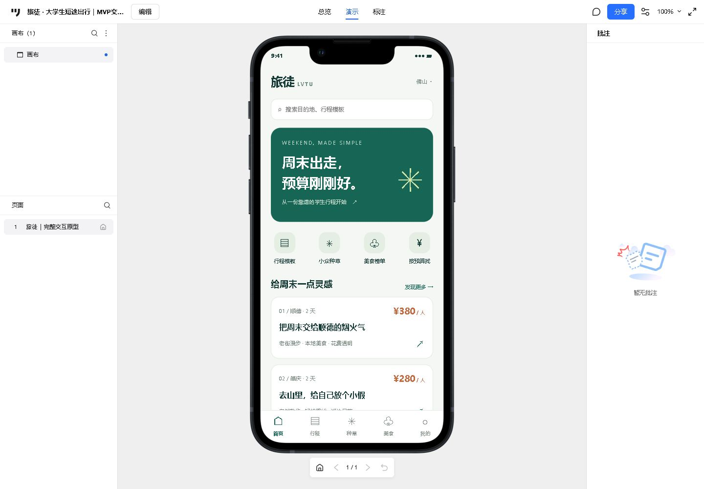
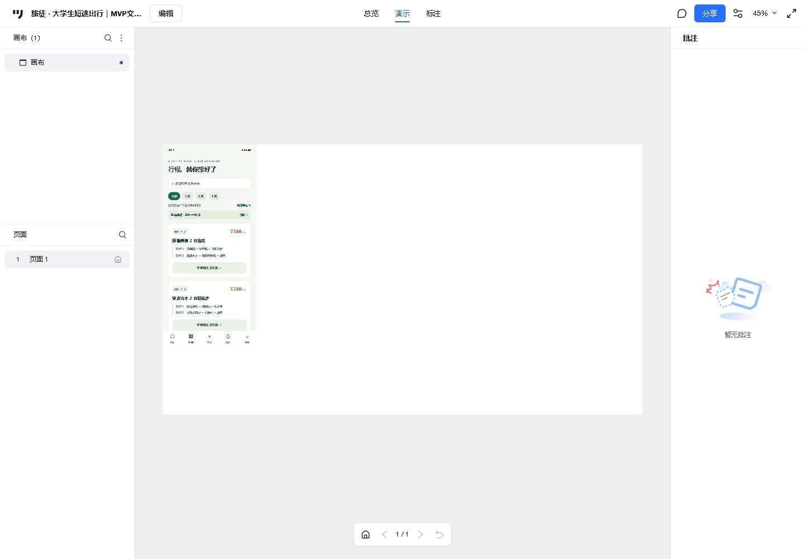

# 旅徒 · 大学生短途出行产品的调研与需求验证

**用 150 份问卷和 1,773 条选择记录，把「大学生短途出行」这个模糊想法，收敛成 10 项需求池和一套 5 屏可点击原型。**

[▶ 在线打开原型](https://2019968.github.io/lvtu-travel-portfolio/prototype/%E6%97%85%E5%BE%92_%E5%AE%8C%E6%95%B4%E4%BA%A4%E4%BA%92%E5%8E%9F%E5%9E%8B.html)　·　[墨刀预览](https://modao.cc/proto/Mrl3EopPtn19bclzU36g4/sharing?view_mode=device&screen=rbpVYH8KVIA8FAbI0&canvasId=rcVYODqcvXZbxdGA)

| 问卷 | 选择记录 | 需求池 | 原型 |
|:---:|:---:|:---:|:---:|
| 150 份 / 24 题 | 1,773 条 | 10 项 | 5 界面 + 3 弹层 |

## 核心结论

| 功能 | 选择率 | 结论 |
|---|---|---|
| 美食红黑榜 | 48.0%（72/150） | 首批功能 |
| 学生行程模板 | 45.3%（68/150） | 首批功能 |

- 两个功能选择率接近，说明「内容型决策」和「工具型规划」是学生出行的两个真实卡点，而不是单纯的价格问题。
- 需求池按「选择率 × 困扰共现」排序，避免只看票数选需求。

## 我怎么做的

1. **调研**：设计 24 题问卷，回收 150 份；设置跳题、重复提交与多选超选校验。
2. **清洗**：把多选答案展开为受访者、答案选择、选项对照三张表，共 1,773 条记录。
3. **分析**：用 SQL 做功能选择率排序与「困扰 × 功能」共现分析，输出 10 项需求池与优先级判断依据。
4. **设计**：按 Q20 结果确定首批功能，完成 5 个主界面 + 3 个弹层的可点击原型。
5. **规划**：设计冷启动的渠道、预算、埋点与回滚判定规则（详见下方文档）。

## 证据

| 内容 | 位置 |
|---|---|
| 项目经过、简历口径与局限 | [项目说明](docs/项目说明.md) |
| 调研结果摘要 | [调研结果摘要](docs/调研结果摘要.md) |
| 需求池与优先级判断 | [需求池 Excel](docs/用户需求池.xlsx)、[判断依据](docs/需求池判断依据.md) |
| SQL 建表、查询与结果 | [sql/](sql/) |
| 可独立运行的交互原型 | [HTML 原型](prototype/旅徒_完整交互原型.html) |
| 墨刀制作与验证记录 | [制作说明](prototype/制作说明.md) |
| 冷启动方案 | [方案设计](docs/冷启动方案设计.md) |

## 状态与局限

- **冷启动方案已设计，尚未执行**：文中给出渠道、预算、埋点与回滚规则，但没有真实投放数据。
- **便利抽样**：广东样本占 50.0%，结论不能直接外推到全国。
- **10 份问卷作答时间低于 90 秒**，未剔除，已在分析中标注风险。

---

本项目为产品运营方向的作品集练习，重点在「调研 → 数据 → 需求 → 原型」的完整链路，而非上线产品。
